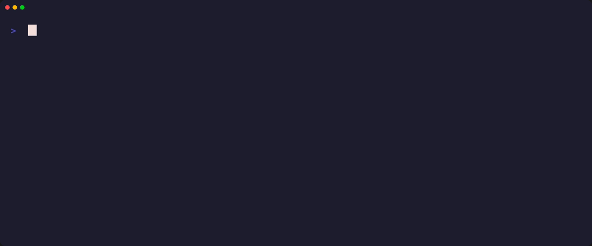

# design-studio
<p align="center"></p>

> **Public-safe design systems surface for FDE delivery — tokens, components, and review checklists.**
**Outcome:** `bash scripts/smoke.sh` checks the public files are in place; the behaviour tests below exercise the `rigds-mcp` server and the Satori/Apple scorecard.


[](https://github.com/mrodgersjs-web/design-studio/actions/workflows/smoke.yml)

## Employer summary
Shows design discipline next to systems work: clear tokens, component contracts, and a review checklist used when embedding with customers.

## Proof in 60 seconds
```bash
git clone https://github.com/mrodgersjs-web/design-studio.git
cd design-studio && bash scripts/smoke.sh
npx skills add mrodgersjs-web/design-studio --skill rig-design-studio-satori-apple
```

## Tests
```bash
pip install -e . pytest
python -m pytest -q tests        # scorecard rules + CLI, compose presets, studio helpers, rigds-mcp over stdio
python mcp/test_contract.py      # tool schemas against frozen fixtures, using a temporary sample studio
python mcp/test_wheel.py         # builds the wheel and runs it from a clean venv
```
CI (`smoke.yml`) runs all of these on Python 3.11 and the 3.10 floor, plus an end-to-end `rigds-mcp` run that scores the bundled `pass.json` and `fail-gate.json`.

Not covered: `rigds_engine` and `rigds_backend` need a private studio checkout and a local backend, so tests use a temporary sample studio and a simulated network failure instead. `mcp/server.py` needs `mcp[cli]` and a private `rig-loop` binary and is not tested here.

## Architecture
```text
brief → tokens → components → a11y/review checklist → handoff
```

## Public boundary
No private brand OS dumps, no customer Figma exports with confidential product IP.
See `docs/public-boundary.md`.

## Video
- [`assets/demo.mp4`](assets/demo.mp4)

## Related
- [fde-portfolio](https://github.com/mrodgersjs-web/fde-portfolio)
- [doctrine](https://github.com/mrodgersjs-web/doctrine)
