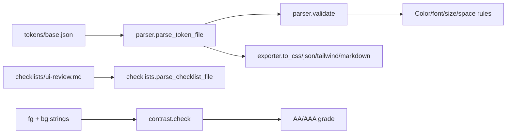

# design-studio


[](https://github.com/mrodgersjs-web/design-studio/actions/workflows/ci.yml)
[](LICENSE)
[](pyproject.toml)

Read, validate and export design tokens; check WCAG contrast; render UI
review checklists. For designers, libraries and small apps that need a
real design-token model that is pure Python, fully typed, and committed
alongside the tokens it consumes.

## Quickstart

```bash
git clone https://github.com/mrodgersjs-web/design-studio.git
cd design-studio
python3 -m pip install -e ".[dev]"
tokens-toolkit validate tokens/base.json
tokens-toolkit contrast '#F5F0EB' '#0A0806'
```

## Usage

### Token file format

`tokens/base.json` is a JSON object. Tokens are dot-paths under a
group; the group name decides the kind:

* `color.*` - a CSS color (`#rgb`, `#rrggbb`, `#rrggbbaa`,
  `rgb(...)`, `rgba(...)`)
* `font.*` - a font family name
* `size.*` / `space.*` - a length (`1rem`, `16px`,
  `clamp(2rem, 5vw, 3.5rem)`)

The value can be either a string shorthand or `{"$value": "..."}`:

```json
{
  "$schema": "https://mrodgersjs-web.github.io/design-studio/tokens/v1",
  "color": {"bg": {"$value": "#0b1220"}, "fg": {"$value": "#e5e7eb"}},
  "font":  {"sans": "Hanken Grotesk"},
  "size":  {"sm": {"$value": "0.875rem"}, "hero": "clamp(2rem, 5vw, 3.5rem)"},
  "space": {"sm": "0.5rem", "section": "clamp(4.5rem, 3rem + 6vw, 11rem)"}
}
```

### CLI

```bash
tokens-toolkit validate  tokens/base.json
tokens-toolkit export    tokens/base.json --format css
tokens-toolkit export    tokens/base.json --format json
tokens-toolkit export    tokens/base.json --format tailwind
tokens-toolkit export    tokens/base.json --format markdown
tokens-toolkit contrast  '#000000' '#ffffff'
tokens-toolkit checklist checklists/ui-review.md --format json
tokens-toolkit tokens     tokens/base.json
```

Every command reads stdin (`-`) or a file argument, prints JSON to
stdout, exits 0 on success, 1 on a validation failure, 2 on bad input.

### Programmatic

```python
from tokens_toolkit import parser, contrast, exporter

tf = parser.parse_token_file("tokens/base.json")
errors = parser.validate(tf)
print(exporter.to_css(tf))
result = contrast.check("#F5F0EB", "#0A0806")
print("AA" if result.aa_normal else "FAIL")
```

## Why this exists

Most projects either ship raw CSS variables with no machine-readable
source, or pick up a token pipeline that drags a runtime dependency.
`design-studio` keeps the model small enough to commit alongside the
tokens it consumes: one JSON file, one Python package that reads it,
and one CLI that turns it into CSS / Tailwind / Markdown. The
contrast checker lets you grade any fg/bg pair your shipped view uses
without leaving the terminal.

## How it works



## What it proves

| What | Command |
| --- | --- |
| Parser | `python -m pytest -q tests/test_parser.py` |
| Contrast (WCAG) | `python -m pytest -q tests/test_contrast.py` |
| Exporters | `python -m pytest -q tests/test_exporter.py` |
| Checklists | `python -m pytest -q tests/test_checklists.py` |
| CLI | `python -m pytest -q tests/test_cli.py` |
| Lint | `python -m ruff check .` |
| End-to-end | `bash scripts/smoke.sh` |
| CI matrix Python 3.10-3.13 | `.github/workflows/ci.yml` |

## Project layout

```text
src/tokens_toolkit/   parser, contrast, exporter, checklists, cli, py.typed
tests/                conftest + 5 test modules, 69 tests
tokens/base.json     the production token source
checklists/ui-review.md  structured UI review checklist
scripts/smoke.sh      end-to-end check
docs/                 architecture, public-boundary, evaluation-strategy
.github/              ci.yml, dependabot.yml, ISSUE_TEMPLATE, PULL_REQUEST_TEMPLATE
                      CHANGELOG.md, CODE_OF_CONDUCT.md, CONTRIBUTING.md,
                      SECURITY.md, LICENSE, CITATION.cff
```

## Development

```bash
python3 -m pip install -e ".[dev]"
python -m ruff check .
python -m pytest -q --cov=tokens_toolkit
bash scripts/smoke.sh
```

## Contributing

Public-boundary safe. See [docs/public-boundary.md](docs/public-boundary.md)
and [CONTRIBUTING.md](CONTRIBUTING.md).

## Security

See [SECURITY.md](SECURITY.md). Report exploitable bugs to
**security@rodgersintelligence.com**, no public issue.

## License

[MIT](LICENSE).

---

Built by Mike Rodgers · [rodgersintelligence.com](https://rodgersintelligence.com)
